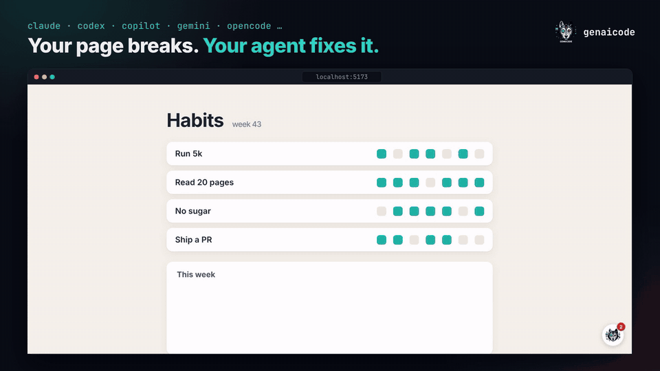
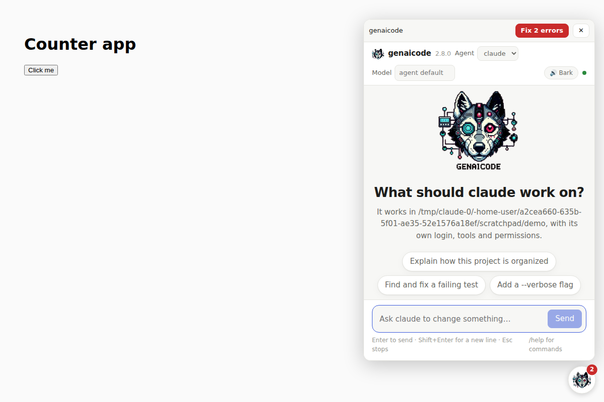

<p align="center">
  <picture>
    <source media="(prefers-color-scheme: dark)" srcset="docs/media/logo-dark.png">
    <source media="(prefers-color-scheme: light)" srcset="docs/media/logo.png">
    
  </picture>
</p>

<p align="center">
  <b>One API and one CLI for the coding agents you already have.</b><br>
  Claude Code · Codex · Copilot CLI · Cursor · Gemini CLI · opencode · Muse · Mistral Vibe · Antigravity
</p>

<p align="center">
  <a href="docs/media/showcase.mp4">
    
  </a>
  <br>
  <sub>Recorded live with Claude Code and Codex. <a href="docs/media/showcase.mp4">Full video (87 s)</a>.</sub>
</p>

## Quick start

```bash
npx genaicode                                         # chat with your agent in this terminal
npx genaicode ui                                      # the same chat in your browser
npx genaicode run --verify "npm test" "fix the failing tests"
npx genaicode embed                                   # let your agent wire genaicode into your app
```

`run --verify` runs the first agent CLI it finds, then your check; a failing check goes back
to the agent for another try. `-a codex` (or `claude`, `copilot`, `opencode`...) picks the
agent, and the command stays the same. Node.js 20+; the agent CLIs are yours to install and
log in to (`npx genaicode agents` lists what it finds).

## What's inside

| Use it as                      | Import / command                       | Docs                              |
| ------------------------------ | -------------------------------------- | --------------------------------- |
| A TypeScript API over agents   | `genaicode/agents`                     | [agents.md](docs/agents.md)       |
| CLI, terminal and browser chat | `genaicode run`, `chat`, `ui`, `embed` | [cli.md](docs/cli.md)             |
| A panel in your dev server     | `genaicode/vite`, `createDevOverlay`   | [vite.md](docs/vite.md)           |
| A chat component               | `genaicode/react` `<AgentChat>`        | [react.md](docs/react.md)         |
| An agent inside your own app   | `genaicode/app-agent`                  | [app-agent.md](docs/app-agent.md) |
| Editors, desktop, game engines | `genaicode acp`, `genaicode/ui`        | [embedding.md](docs/embedding.md) |
| A thin LLM layer               | `genaicode`, `genaicode/providers`     | [llm.md](docs/llm.md)             |

```ts
import { codex } from 'genaicode/agents';

const run = codex().run({ prompt: 'Add a unit test for parseDate', cwd: '/path/to/repo' });
for await (const event of run) if (event.type === 'file-change') console.log('edited', event.paths);
const result = await run.result; // { status, ok, text, sessionId, usage, ... }
```

Every driver gives the same events and result. On top: steering a running task, approvals
and sandbox policy (`permissions`, or `'yolo'`), per-task MCP servers, and verify-and-repair.
The agent keeps its own login, billing and sandbox; GenAIcode picks no model and adds no
agent loop of its own.

<p align="center">
  <picture>
    <source media="(prefers-color-scheme: dark)" srcset="docs/media/screenshots/vite-dark.png">
    <source media="(prefers-color-scheme: light)" srcset="docs/media/screenshots/vite-light.png">
    
  </picture>
</p>

## Install

```bash
npm install genaicode
```

Importing `genaicode` never spawns an agent, and `genaicode/agents` loads no provider SDK
and no UI code.

## More

- [Changelog](docs/CHANGELOG.md), [semver policy](docs/semver.md), [releasing](docs/releasing.md)
- Coming from 1.x? It was a built-in coding agent; it lives on the
  [`1.x` branch](https://github.com/gtanczyk/genaicode/tree/1.x) and as `npx genaicode@1`.
  See [the pivot plan](docs/pivot.md).
