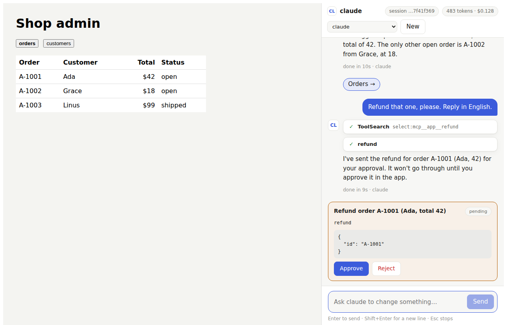

# Agent inside your app (`genaicode/app-agent`)

[← README](../README.md)

`genaicode/app-agent` puts an agent in a local app you run on your machine (an admin
console, an internal tool, a game editor). The user chats with an agent CLI they already
have; the agent works the app through tools the app serves over MCP, changes wait for the
user's approval, and in `dev` mode the agent also edits the app's code and proposes a commit.

```ts
import { createServer } from 'node:http';
import { createAppAgent, createAppAgentHandler } from 'genaicode/app-agent';

const agent = createAppAgent({
  name: 'the shop admin',
  mcpUrl: 'http://127.0.0.1:3000/api/agent/mcp',
  tools: [
    { name: 'orders', description: 'List open orders.', run: () => JSON.stringify(listOrders()) },
    {
      name: 'refund',
      description: 'Refund an order.',
      write: true, // a card with Approve and Reject; runs only after Approve
      inputSchema: { type: 'object', properties: { id: { type: 'string' } }, required: ['id'] },
      run: ({ id }) => refund(String(id)),
    },
  ],
  pages: () => ['/orders', '/customers'], // page context, link chips, "take me there"
  dev: { cwd: process.cwd(), commands: ['npm test'] }, // optional: the agent edits the app
});
const handle = createAppAgentHandler(agent, { authorize: (req) => isSignedIn(req) });

createServer(async (req, res) => {
  if (await handle(req, res)) return;
  // ...the rest of the app
}).listen(3000, '127.0.0.1');
```

On the page, `AppAgentChat` from `genaicode/react` is the whole drawer: the chat, the agent's
page chips under its replies, Approve and Reject cards (with the diff of a proposed commit),
and the agent and mode pickers. It reports `currentPath` to the agent and calls `onNavigate`
when a chip is clicked or the agent is asked to go somewhere.

```tsx
import { AppAgentChat } from 'genaicode/react';
import 'genaicode/react/styles.css';

<AppAgentChat currentPath={location.pathname} onNavigate={(path) => router.push(path)} />;
```

<p align="center">
  
</p>

A read tool may return `{ text, images: [{ mimeType: 'image/png', data }] }` instead of a
string, so the agent can look at what it changed, e.g. a screenshot of the app.

Under it, `/api/agent` serves `GET /events` (a stream of `AppAgentState`: the session, earlier
turns, pending actions, link chips, navigation requests) and `POST /send`, `/stop`, `/reset`,
`/config`, `/view`, `/actions/:id` and `/approvals/:id` (the agent CLI's own permission
prompts; `autoApprove` answers the ones the app decides itself); `useAppAgent` wraps them for a page of your own. Switching agent or mode keeps the
conversation: the next agent gets a short transcript. `trace` receives every prompt, MCP call,
decision and finished turn, for a log. Default agents are Claude Code, Codex and
Copilot CLI, locked down per mode: in `use` mode they get only the app's tools (no shell, no
file edits); in `dev` mode they edit files and run the listed commands, never commit or push (Claude and
Copilot enforce the command list; Codex has no per-command allowlist, so it runs in its
`workspace-write` sandbox: writes only inside `cwd`, no network).
`propose_commit` snapshots the worktree, the user reviews that diff, and Approve commits
exactly that tree on the reviewed HEAD, or refuses if the files or HEAD changed since, a hook
changed the files, or a merge or rebase is in progress. The repository's commit hooks run. An app that delivers the
edits itself (syncs the files, uploads them) passes `dev.commit: false`, so the agent gets no
`propose_commit`, and `dev.only: true` when there is nothing to do in `use` mode.
The agent sees no MCP server but the app's: Claude runs with `--strict-mcp-config`, and Codex
and Copilot get the user's own configured servers switched off. The MCP endpoint takes a per-run
bearer and refuses browser requests; every other route asks `authorize` and refuses
cross-site requests. Without `authorize` only a loopback `Host` is accepted (add names with
`allowedHosts`), so a DNS-rebinding page cannot reach the agent.

## The agent drives the app (a game)

The same tools let the agent use the app the way a person does: play a level, click through a
flow, reproduce a bug. Give it a way to look and a way to act, and make taking control visible.

```ts
let controlled = false; // the page shows "Agent controls this game" and a Take back control button

const agent = createAppAgent({
  name: 'the game in the dev build',
  instructions: 'Call game_take_control before game_act. Observe after each move.',
  tools: [
    {
      name: 'game_observe',
      description: "The game's state and a screenshot of the current frame.",
      run: async () => ({ text: JSON.stringify(game.state()), images: [await game.screenshot()] }),
    },
    {
      name: 'game_take_control',
      description: 'Take the controls from the player.',
      run: () => ((controlled = true), 'ok'),
    },
    {
      name: 'game_act',
      description: 'Press keys or click, then let the game run for `frames` frames.',
      inputSchema: {
        type: 'object',
        properties: { keys: { type: 'array', items: { type: 'string' } }, frames: { type: 'integer', maximum: 120 } },
      },
      validate: () => {
        if (!controlled) throw new Error('Call game_take_control first.');
      },
      // The schema is a hint to the agent; the bound is enforced here.
      run: async ({ keys, frames }) =>
        game.step(
          Array.isArray(keys) ? keys.map(String) : [],
          Math.min(Math.max(Math.trunc(Number(frames) || 10), 1), 120),
        ),
    },
    { name: 'game_release_control', description: 'Give the controls back.', run: () => ((controlled = false), 'ok') },
  ],
});

// The player can always take control back, and control never outlives the agent's turn.
agent.subscribe((state) => {
  if (state.session?.status !== 'running') controlled = false;
});
```

What makes this work:

- **No approval cards for moves.** These tools are not `write`, so each call runs at once. Keep
  `write: true` for what should wait for the user (deleting a save, publishing a build).
- **Observe returns pixels.** A read tool may return `images`; the agent sees the frame, not only
  the numbers. Keep screenshots small (a few hundred pixels wide) so the turn stays fast.
- **Bound every move.** `game_act` advances a limited number of frames and returns, so the agent
  plays in short steps and a stuck call cannot hang the turn.
- **Control is visible and revocable.** Show who drives in the page, let a click give control back
  (the next `game_act` then fails with a message the agent reads), and drop control when the turn
  ends or the user presses Stop.
- **Pause when nobody acts**, if the game allows it, so the agent's thinking time does not cost
  the player their run.

Outside a browser (a Godot or Unity editor, a native app) the game serves the same tools from
its own MCP server; see [embedding.md](./embedding.md).
