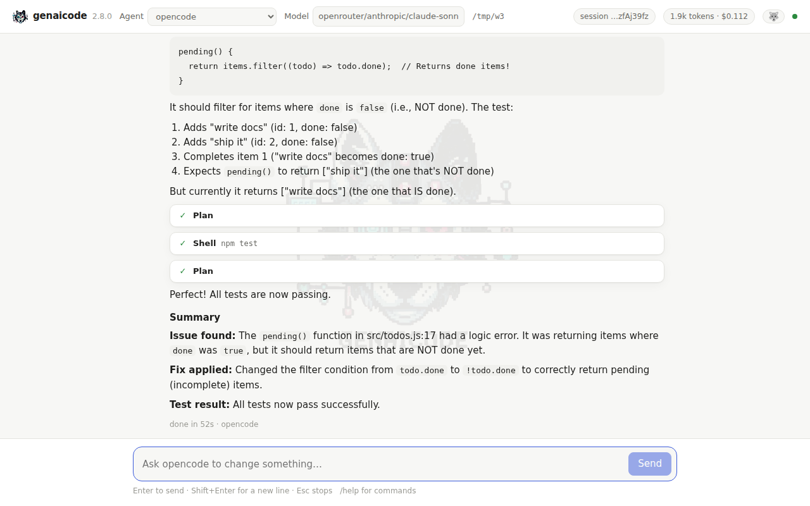

# Command line: install, run, chat, ui, embed, acp

[← README](../README.md)

## Install the command

`npx genaicode` works without installing anything. To type just `genaicode`, and have it
update itself, run the installer (macOS and Linux, Node.js 20+ with npm):

```bash
curl -fsSL https://raw.githubusercontent.com/gtanczyk/genaicode/master/scripts/install.sh | sh
```

It is a short shell script ([scripts/install.sh](../scripts/install.sh), read it first) that
`npm install`s the published package without lifecycle scripts into
`~/.genaicode/versions/<version>`, points `~/.genaicode/current` at it and writes a
`~/.local/bin/genaicode` shim. Nothing needs sudo. If `~/.local/bin` is not on your `PATH`,
it prints the line to add to your shell profile. `GENAICODE_VERSION`, `GENAICODE_HOME` and
`GENAICODE_BIN_DIR` change the version, the install directory and the bin directory.

```bash
genaicode update            # install the latest version now and print what changed
genaicode update --check    # only say whether a newer version is out
genaicode update --version 2.35.1
genaicode update --auto off # stop the daily check (--auto on brings it back)
```

Once a day, a `genaicode` start looks for a new version in the npm registry, in a background
process, so the command never waits on the network. A new version installs beside the
running one and `current` switches over in one step, so running sessions are not disturbed
and the next start uses it; that start prints one line with the old and new versions and
the release notes link. The previous version and any still running are kept; older ones are removed.
`GENAICODE_NO_AUTO_UPDATE=1` (and `CI`) skip the check for one run. Windows, `npx`, a global
`npm install -g genaicode` and a project dependency update through npm as usual.

To uninstall, remove `~/.genaicode` and `~/.local/bin/genaicode`.

## From the command line

The `genaicode` bin runs the same headless drivers without writing any code:

```bash
npx genaicode agents                                   # which agent CLIs are installed
npx genaicode run "Add a unit test for parseDate"      # first installed agent, current dir
npx genaicode run -a codex -C ../api --verify "npm test" "Fix the failing date tests"
git diff | npx genaicode run --json -a claude -        # prompt from stdin, JSON-lines events
```

Assistant text goes to stdout and tool calls, edits, and the result line go to stderr.
`--verify` runs a shell command after the agent finishes and sends its output back for up
to `--max-repairs` more attempts (`runWithVerify`). The exit code is 0 on success, 1 when
the agent or the check fails, 2 on a usage error, and 130 when interrupted.
`--max-tokens <n>` and `--max-cost <usd>` stop the agent once it goes over (with `--verify`,
over all attempts together); a line on stderr warns at 80% and when the agent's plan limit
gets close. `--fallback codex,gemini` runs the task on the next agent when one is out of quota,
not signed in, not installed or crashed (see [failover](agents.md#failover)).
`npx genaicode --help` lists every option.

## Sessions across agents

```bash
npx genaicode sessions                       # what every agent has going on, by project
npx genaicode sessions --since 7d -C ../api  # last week, one project
npx genaicode sessions -a codex --json       # one JSON object per session
npx genaicode sessions --cloud               # also Cursor Cloud Agents (CURSOR_API_KEY)
npx genaicode sessions --waiting             # only what waits for you, approvals first
```

It reads the stores the agents keep on this machine (Claude Code, Codex, Copilot, Cursor, Gemini
CLI, Antigravity, Muse and Vibe) and changes nothing. SQLite-backed stores (Codex, Muse,
Antigravity, Cursor's model lookup and Copilot's `session-store.db` fallback) need Node 22.5 or
newer (`node:sqlite`); the other stores work on Node 20+.
`●` is a session an agent is working in now, `○` one that waits for you, `◌` one that stopped
half way. After `npx genaicode hooks install`, Claude Code, Codex, Gemini, Copilot and Cursor report what their sessions
do, and `◆` marks one that asks for approval (see [hooks](agents.md#which-sessions-need-you-hooks)). Each line ends with the session id; `genaicode chat -a <agent> -C <dir> -r <id>`
continues it (see [sessions](agents.md#sessions-across-agents)).

`npx genaicode notify on` then shows a desktop notification when a session asks for approval
(`--done`: also when one finishes its turn; see [notify](agents.md#being-told-notify)).

With `hooks install --answer`, Claude Code's approval questions can also be answered from here:
`sessions --waiting` lists them, `sessions approve <q>` / `sessions deny <q> -m <why>` answer, and
the browser's Sessions view has Approve and Deny (see
[answering](agents.md#answering-from-the-tower-hooks-install---answer)).

`npx genaicode sessions archive --stale` puts away every session left waiting or half way for 2
days or more (`sessions archive <id>` for one, `unarchive` to bring it back, `--archived` to list
them); the agents' files stay as they are (see
[archive](agents.md#putting-sessions-away-sessions-archive)).

`npx genaicode sessions doctor` checks that those stores still read as expected after an agent
updates: counts per store, never content, exit code 1 when one looks broken (see
[sessions doctor](agents.md#when-an-agent-changes-its-store-sessions-doctor)).

`npx genaicode chat --sessions` gives the chat's agent that index as tools, so you can ask it what
is open or what waits for you in every agent; `npx genaicode sessions mcp` serves the same tools
to any agent as a stdio MCP server (see
[sessions mcp](agents.md#asking-an-agent-about-the-sessions-sessions-mcp)). The agent that has
them reads what the other sessions said.

## Chat with an agent: terminal and browser

```bash
npx genaicode                      # chat in this terminal (same as "genaicode chat")
npx genaicode chat -a claude -C ../api
npx genaicode ui                   # the same chat in your browser, served on 127.0.0.1
npx genaicode chat --web           # both: the terminal and the browser on one session
```

In the browser, **Sessions** in the header shows what every agent on this machine has going on:
the same list as `genaicode sessions`, by project, with search over titles, prompts, directories
and branches, and filters by agent, state and period. A local session gives the command that
continues it in a terminal, and **Continue here** when it is from this directory; a cloud session
links to its page.

The terminal and the browser can show one session. `/web` in the terminal chat opens it in
the browser (`/web off` stops the server), and Enter in the terminal that runs
`genaicode ui` brings it into that terminal. A prompt, an approval or a stop from either
side shows up in both.

Each prompt after the first continues the agent's own session (`AgentTask.resume`), so you
can say "now add a test for that". Prompts sent while the agent works wait in a queue and
run next; Esc stops the agent. When the agent asks for permission, `y` approves, `n`
denies and `a` approves everything from then on (`/auto`, or the Auto-approve chip in the
browser; `-y` starts that way). `!` on an empty prompt switches to shell mode, as in Claude
Code: `!npm run dev` runs in the project with its output in the transcript, and `/stop` (or
Esc) ends it. `/agent`, `/model` and `/new` switch agent,
model and session; `/fallback codex,gemini` picks the agents to switch to when the current one
runs out (`/fallback off` stops it); `/help` lists the rest. `/agent codex` hands the
conversation over: codex gets a recap and a transcript file in `.genaicode/handoff/`, and
switching back resumes the earlier agent's own session (`/agent codex --fresh` starts with no
context).

A session from `genaicode sessions` continues the same way, in whichever agent you like:

```sh
npx genaicode chat -a codex --from a1b2c3d4      # codex takes over a Claude Code session
npx genaicode run -a gemini --from a1b2c3d4 "Finish the export and run the tests"
```

`--from` takes a session id or the start of one. The session's turns show in the chat, and the
agent hears them with your first prompt: its own agent resumes the session, another one gets the
recap and the transcript file. `/continue <id>` does it inside a chat, and **Continue here** in
the browser's Sessions view. It works for sessions from the directory genaicode runs in (`-C`) or below it, in the
stores genaicode can read conversations from (every agent `genaicode sessions` lists locally, except Cursor).

<p align="center">
  <picture>
    <source media="(prefers-reduced-motion: reduce)" srcset="media/screenshots/chat-terminal.png">
    
  </picture>
  <picture>
    <source media="(prefers-reduced-motion: reduce) and (prefers-color-scheme: dark)" srcset="media/screenshots/wolf-dark.png">
    <source media="(prefers-reduced-motion: reduce)" srcset="media/screenshots/wolf-light.png">
    <source media="(prefers-color-scheme: dark)" srcset="media/screenshots/chat-browser-dark.gif">
    <source media="(prefers-color-scheme: light)" srcset="media/screenshots/chat-browser-light.gif">
    
  </picture>
</p>

The wolf from genaicode 1.0 is back. When the agent asks for approval or finishes, the
browser UI barks if its tab is in the background and counts those events in the tab title.
The terminal UI rings the terminal bell instead. `/bark off` (or the Bark button) quiets it.

<p align="center">
  <picture>
    <source media="(prefers-color-scheme: dark)" srcset="media/screenshots/wolf-dark.png">
    <source media="(prefers-color-scheme: light)" srcset="media/screenshots/wolf-light.png">
    
  </picture>
</p>

`--mcp name=url` (repeatable) gives the agent an MCP server over streamable HTTP for every
prompt, e.g. `genaicode ui --mcp game=http://127.0.0.1:7777/mcp` from a game editor whose
running game serves tools there. Only the agents that take MCP servers in genaicode (claude,
codex, copilot) are offered then.
The agent can publish artifacts: a report, chart or mockup as a self-contained HTML page, an
image, a Markdown document. The browser UI shows each as a card that opens a preview; the
terminal shows a line, and `/web` opens the browser on the same session. Pages run in a
sandboxed frame with no network and no access to the UI (see
[agents.md](agents.md#artifacts)). Agents that take MCP servers get the tool;
`--no-artifacts` leaves it out.
An app that starts `genaicode ui` itself can add `--exit-with-stdin` and stop it by closing
its stdin, which also reaches the server when a launcher such as npx sits in between.

`genaicode ui` listens on the loopback address and prints a link with a random access
token. The page, the event stream and every command need that token; only the bundled
script and the four mascot files (`/app.js`, `/assets/…`) are served without it, since they
hold nothing about your session. Both front ends are bundled into the package and load
only for these commands; importing `genaicode` or `genaicode/agents` pulls in no UI code.
In code, the same conversation is `createAgentSession` from `genaicode/agents` (see
[agents.md](agents.md#chat-sessions)); with a live driver (`codexLive`,
`museLive`) it also steers the running agent and asks you about permission requests.

## Let your agent embed it

```bash
npx genaicode embed                      # in your project: your agent wires genaicode in
npx genaicode embed -a codex "only the dev panel"
npx genaicode embed --print | pbcopy     # just the instructions, for any other agent
```

`genaicode embed` does not inspect your project itself. It starts your agent with
instructions on how to embed genaicode, and the agent reads the project and picks the way
in: the [Vite overlay](vite.md) for an app on Vite; for any other Node dev server (webpack,
Next.js, Express...) the same overlay through `createDevOverlay` from `genaicode/ui`; for
pages with no dev server at all, a small dev-only server of its own with that overlay; the in-app agent (`genaicode/app-agent` with
`<AppAgentChat>`) when the agent should act on the app's data; a panel over `genaicode acp`
for a desktop app, a game engine editor (Godot, Unity...) or an app in another language; and
`npx genaicode ui` next to the dev server when there is nothing to add a panel to. Any of
them can also let the agent drive the running app (play the game, click through a flow)
through observe / take control / act / release tools ([embedding.md](embedding.md#let-the-agent-act-on-the-app)).
Words after `embed` go to the
agent as your request. You watch and answer in the same chat as `genaicode chat` (`--ui`
for the browser); without a terminal it runs headless like `run`. The agent installs the
package, edits the config, runs your checks and reports; it does not commit.

The instructions are also a Claude Code skill. Copy
[`skills/genaicode-embed`](skills/genaicode-embed/SKILL.md) into `.claude/skills/` (or
`~/.claude/skills/`) and ask Claude to "embed genaicode":

```bash
mkdir -p .claude/skills && cp -r node_modules/genaicode/docs/skills/genaicode-embed .claude/skills/
```

## For editors and apps in other languages: `genaicode acp`

```bash
npx genaicode acp -a claude
```

`genaicode acp` serves the [Agent Client Protocol](https://agentclientprotocol.com) on stdin
and stdout, for editors that speak it (Zed, JetBrains IDEs) and for any app that starts it as a
child process: a Godot or Unity editor plugin, a Tauri or native app, a Python tool. Sessions,
streamed replies and tool calls, permission requests and cancel go over the protocol; the host
picks the agent, effort and approvals per session. See [embedding.md](embedding.md#any-language-the-agent-client-protocol).
