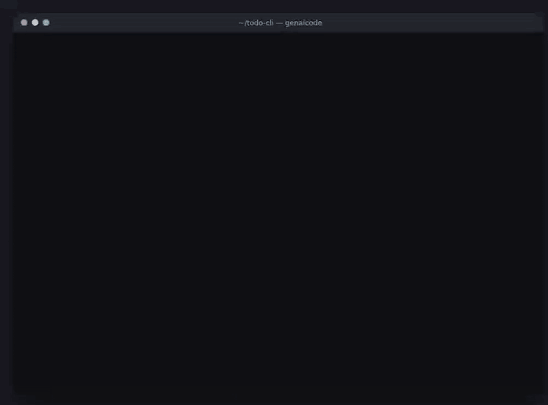
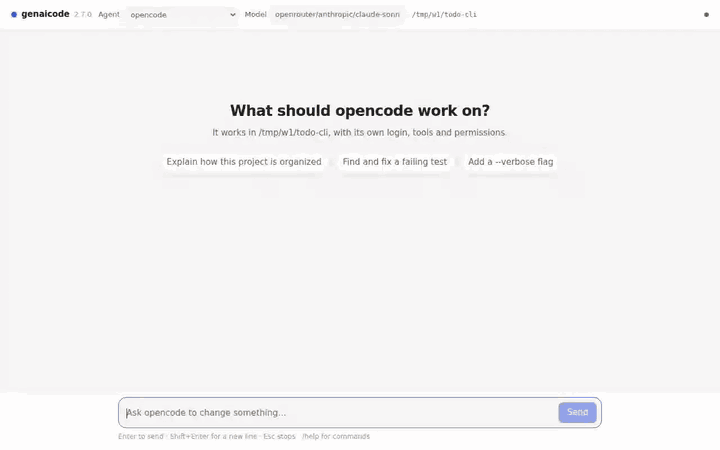
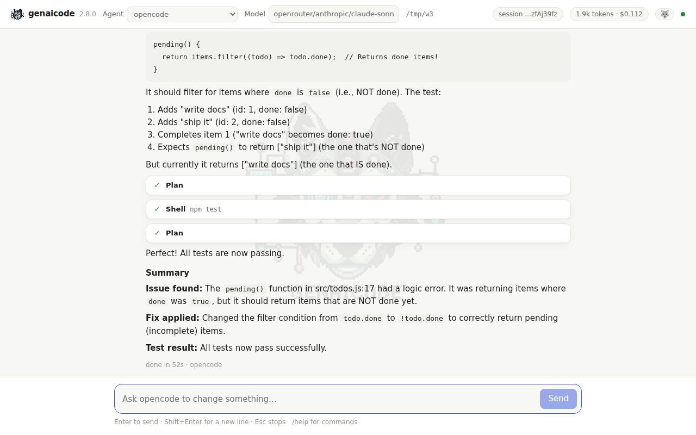

# Command line: run, chat, ui, embed, acp

[← README](../README.md)

## From the command line

The `genaicode` bin runs the same headless drivers without writing any code:

```bash
npx genaicode agents                                   # which agent CLIs are installed
npx genaicode run "Add a unit test for parseDate"      # first installed agent, current dir
npx genaicode run -a codex -C ../api --verify "npm test" "Fix the failing date tests"
git diff | npx genaicode run --json -a claude -        # prompt from stdin, JSON-lines events
```

Assistant text goes to stdout and tool calls, edits, and the result line go to stderr.
`--verify` runs a shell command after the agent finishes and sends its output back for up
to `--max-repairs` more attempts (`runWithVerify`). The exit code is 0 on success, 1 when
the agent or the check fails, 2 on a usage error, and 130 when interrupted.
`npx genaicode --help` lists every option.

## Chat with an agent: terminal and browser

```bash
npx genaicode                      # chat in this terminal (same as "genaicode chat")
npx genaicode chat -a claude -C ../api
npx genaicode ui                   # the same chat in your browser, served on 127.0.0.1
npx genaicode chat --web           # both: the terminal and the browser on one session
```

The terminal and the browser can show one session. `/web` in the terminal chat opens it in
the browser (`/web off` stops the server), and Enter in the terminal that runs
`genaicode ui` brings it into that terminal. A prompt, an approval or a stop from either
side shows up in both.

Each prompt after the first continues the agent's own session (`AgentTask.resume`), so you
can say "now add a test for that". Prompts sent while the agent works wait in a queue and
run next; Esc stops the agent. When the agent asks for permission, `y` approves, `n`
denies and `a` approves everything from then on (`/auto`, or the Auto-approve chip in the
browser; `-y` starts that way). `!` on an empty prompt switches to shell mode, as in Claude
Code: `!npm run dev` runs in the project with its output in the transcript, and `/stop` (or
Esc) ends it. `/agent`, `/model` and `/new` switch agent,
model and session; `/help` lists the rest.

<p align="center">
  <picture>
    <source media="(prefers-reduced-motion: reduce)" srcset="media/screenshots/chat-terminal.png">
    
  </picture>
  <picture>
    <source media="(prefers-reduced-motion: reduce) and (prefers-color-scheme: dark)" srcset="media/screenshots/wolf-dark.png">
    <source media="(prefers-reduced-motion: reduce)" srcset="media/screenshots/wolf-light.png">
    <source media="(prefers-color-scheme: dark)" srcset="media/screenshots/chat-browser-dark.gif">
    <source media="(prefers-color-scheme: light)" srcset="media/screenshots/chat-browser-light.gif">
    
  </picture>
</p>

The wolf from genaicode 1.0 is back. When the agent asks for approval or finishes, the
browser UI barks if its tab is in the background and counts those events in the tab title.
The terminal UI rings the terminal bell instead. `/bark off` (or the Bark button) quiets it.

<p align="center">
  <picture>
    <source media="(prefers-color-scheme: dark)" srcset="media/screenshots/wolf-dark.png">
    <source media="(prefers-color-scheme: light)" srcset="media/screenshots/wolf-light.png">
    
  </picture>
</p>

`genaicode ui` listens on the loopback address and prints a link with a random access
token. The page, the event stream and every command need that token; only the bundled
script and the four mascot files (`/app.js`, `/assets/…`) are served without it, since they
hold nothing about your session. Both front ends are bundled into the package and load
only for these commands; importing `genaicode` or `genaicode/agents` pulls in no UI code.
In code, the same conversation is `createAgentSession` from `genaicode/agents` (see
[agents.md](agents.md#chat-sessions)); with a live driver (`codexLive`,
`museLive`) it also steers the running agent and asks you about permission requests.

## Let your agent embed it

```bash
npx genaicode embed                      # in your project: your agent wires genaicode in
npx genaicode embed -a codex "only the dev panel"
npx genaicode embed --print | pbcopy     # just the instructions, for any other agent
```

`genaicode embed` does not inspect your project itself. It starts your agent with
instructions on how to embed genaicode, and the agent reads the project and picks the way
in: the [Vite overlay](vite.md) for an app on Vite; for any other Node dev server (webpack,
Next.js, Express...) the same overlay through `createDevOverlay` from `genaicode/ui`; for
pages with no dev server at all, a small dev-only server of its own with that overlay; the in-app agent (`genaicode/app-agent` with
`<AppAgentChat>`) when the agent should act on the app's data; a panel over `genaicode acp`
for a desktop app, a game engine editor (Godot, Unity...) or an app in another language; and
`npx genaicode ui` next to the dev server when there is nothing to add a panel to. Any of
them can also let the agent drive the running app (play the game, click through a flow)
through observe / take control / act / release tools ([embedding.md](embedding.md#let-the-agent-act-on-the-app)).
Words after `embed` go to the
agent as your request. You watch and answer in the same chat as `genaicode chat` (`--ui`
for the browser); without a terminal it runs headless like `run`. The agent installs the
package, edits the config, runs your checks and reports; it does not commit.

The instructions are also a Claude Code skill. Copy
[`skills/genaicode-embed`](skills/genaicode-embed/SKILL.md) into `.claude/skills/` (or
`~/.claude/skills/`) and ask Claude to "embed genaicode":

```bash
mkdir -p .claude/skills && cp -r node_modules/genaicode/docs/skills/genaicode-embed .claude/skills/
```

## For editors and apps in other languages: `genaicode acp`

```bash
npx genaicode acp -a claude
```

`genaicode acp` serves the [Agent Client Protocol](https://agentclientprotocol.com) on stdin
and stdout, for editors that speak it (Zed, JetBrains IDEs) and for any app that starts it as a
child process: a Godot or Unity editor plugin, a Tauri or native app, a Python tool. Sessions,
streamed replies and tool calls, permission requests and cancel go over the protocol; the host
picks the agent, effort and approvals per session. See [embedding.md](embedding.md#any-language-the-agent-client-protocol).
