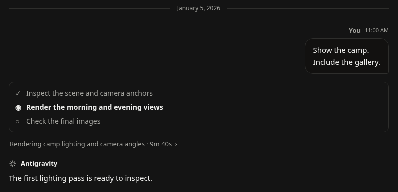
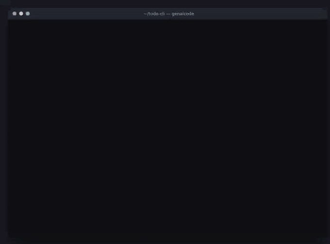
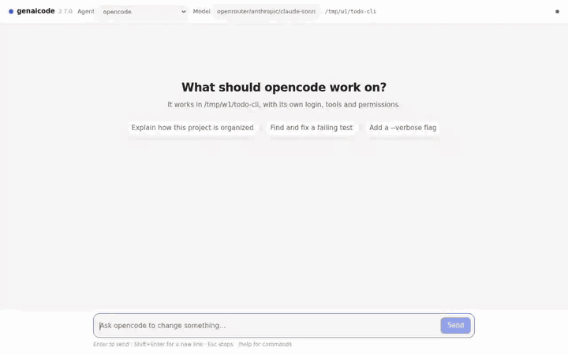

# Command line: install, run, chat, ui, embed, acp

[← README](../README.md)

## Install the command

`npx genaicode` works without installing anything. To type just `genaicode`, and have it
update itself, install it once (macOS and Linux, Node.js 22.5+ with npm):

```bash
npx genaicode install
# or, without npx:
curl -fsSL https://raw.githubusercontent.com/gtanczyk/genaicode/master/scripts/install.sh | sh
```

Both do the same thing (the shell version is [scripts/install.sh](../scripts/install.sh), read
it first): `npm install` the published package without lifecycle scripts into
`~/.genaicode/versions/<version>`, points `~/.genaicode/current` at it and writes a
`~/.local/bin/genaicode` shim. Nothing needs sudo. If `~/.local/bin` is not on your `PATH`,
it prints the line to add to your shell profile. `npx genaicode install` installs the version
npx ran; `--version <v>`, `--bin-dir <dir>` and `GENAICODE_HOME` change the version, the bin
directory and the install directory (for the script: `GENAICODE_VERSION`, `GENAICODE_BIN_DIR`,
`GENAICODE_HOME`).

```bash
genaicode update            # install the latest version now and print what changed
genaicode update --check    # only say whether a newer version is out
genaicode update --version 2.35.1
genaicode update --auto off # stop the daily check (--auto on brings it back)
```

Once a day, a `genaicode` start looks for a new version in the npm registry, in a background
process, so the command never waits on the network. A new version installs beside the
running one and `current` switches over in one step, so running sessions are not disturbed
and the next start uses it; that start prints one line with the old and new versions and
the release notes link. The previous version and any still running are kept; older ones are removed.
`GENAICODE_NO_AUTO_UPDATE=1` (and `CI`) skip the check for one run. Windows, `npx`, a global
`npm install -g genaicode` and a project dependency update through npm as usual.

To uninstall, remove `~/.genaicode` and `~/.local/bin/genaicode`.

## From the command line

The `genaicode` bin runs the same headless drivers without writing any code:

```bash
npx genaicode agents                                   # which agent CLIs are installed
npx genaicode run "Add a unit test for parseDate"      # first installed agent, current dir
npx genaicode run -a codex -C ../api --verify "npm test" "Fix the failing date tests"
git diff | npx genaicode run --json -a claude -        # prompt from stdin, JSON-lines events
```

Assistant text goes to stdout and tool calls, edits, and the result line go to stderr.
`--verify` runs a shell command after the agent finishes and sends its output back for up
to `--max-repairs` more attempts (`runWithVerify`). The exit code is 0 on success, 1 when
the agent or the check fails, 2 on a usage error, and 130 when interrupted.
`--max-tokens <n>` and `--max-cost <usd>` stop the agent once it goes over (with `--verify`,
over all attempts together); a line on stderr warns at 80% and when the agent's plan limit
gets close. `--fallback codex,gemini` runs the task on the next agent when one is out of quota,
not signed in, not installed or crashed (see [failover](agents.md#failover)).
`npx genaicode --help` lists every option.

## Sessions across agents

```bash
npx genaicode sessions                       # what every agent has going on, by project
npx genaicode sessions --since 7d -C ../api  # last week, one project
npx genaicode sessions -a codex --json       # one JSON object per session
npx genaicode sessions --cloud               # also cloud sessions (gh, codex, CURSOR_API_KEY)
npx genaicode sessions --waiting             # only what waits for you, approvals first
```

It reads the stores the agents keep on this machine (Claude Code, Codex, Copilot, Cursor, Gemini
CLI, Antigravity, Muse and Vibe) and changes nothing. SQLite-backed stores (Codex, Muse,
Antigravity, Cursor's model lookup and Copilot's `session-store.db` fallback) are read with
`node:sqlite`.
`--cloud` adds sessions that run elsewhere. The vendors do not list them, but a session that
pushed work signs it: your own pull requests of the last two weeks (asked of GitHub through `gh`,
with your sign-in) are grouped by the claude.ai project thread, Claude Code cloud session or
Codex Cloud task their description links, under the repository, with the pull requests as the
latest word (`Open: owner/repo#12 ...`). A session with an open pull request shows as waiting.
One that pushed nothing is not seen. Codex Cloud tasks also come from `codex cloud list --json`
(the latest twenty), and Cursor Cloud Agents from Cursor's API when `CURSOR_API_KEY` is set.
Without `gh` or `codex` that part is skipped. `-a github` or `-a codex-cloud` shows one of them;
`sessions mcp --cloud` gives them to an agent. In code: `githubCloudSessions()` and
`codexCloudSessions()`, both a `SessionSource`; `joinedCloudSessions(pulls, tasks)` names a Codex
Cloud task that opened a pull request once, as the CLI does.

`●` is a session an agent is working in now, `○` one that waits for you, `◌` one that stopped
half way. After `npx genaicode hooks install`, Claude Code, Codex, Gemini, Copilot and Cursor report what their sessions
do, and `◆` marks one that asks for approval (see [hooks](agents.md#which-sessions-need-you-hooks)). Each line ends with the session id; `genaicode chat -a <agent> -C <dir> -r <id>`
continues it (see [sessions](agents.md#sessions-across-agents)).

To send one message from another directory, use the id from the listing. A unique prefix of at least eight characters also works.

```bash
genaicode sessions send a1b2c3d4 "Which test still fails?"
genaicode sessions send a1b2c3d4 --sandbox read-only "Explain the failure"
genaicode sessions send a1b2c3d4 --detach "Run the regression tests"
```

The original agent resumes the conversation in its own project. Replies stream to stdout.
You can pipe the prompt on stdin or use `-a <agent>` to search one agent's store.
`--detach` returns the background process ID once the agent acknowledges the turn. Its reply
stays in the native conversation. The driver uses its default permissions unless you select
`--sandbox read-only|workspace-write|unrestricted`. Each driver accepts its supported modes.

Prompts to other sessions are sent by a person. In a shell that a coding agent runs (the agent's
CLI marks it with a variable such as `CLAUDECODE` or `GEMINI_CLI`) the command refuses unless you
pass `--force`. This stops an agent sending by accident; it is not a security boundary.

In the browser, choose **Sessions → Reply**, enter the message and choose **Send**. The reply appears
in the Sessions view. Both entry points require a local session that is waiting for a reply or
stopped mid-turn, with a driver that supports resuming. A running turn or pending tool approval
must finish first. The check uses the latest store and hook information available when you send.

`npx genaicode notify on` then shows a desktop notification when a session asks for approval
(`--done`: also when one finishes its turn; see [notify](agents.md#being-told-notify)).

`sessions --waiting` puts the sessions that need you now right after the approvals (`●`: the last
message asked a question, asked you to confirm or decide, or gave a command to run, in the last 3
days), then the stalled ones
(`◇`: an offer to go on, a report that could not be sent back, or a question older than that),
then the ones that just ended. Topics, the browser's start screen and the desktop menu bar count
only what needs you now; stalled sessions are folded under their topic. Scheduled tasks and headless runs nobody typed into
are left out of `sessions`; `--automated` lists them too (see
[agents](agents.md#which-sessions-need-you-hooks)).

With Copilot or Gemini hooks installed, `sessions --waiting`, the tower's `/waiting` command
and the browser's Sessions view show up to 200 characters of a shell command awaiting approval.
Refresh the queue to see which commands still need a decision. Answer in the agent that asked.
Copilot reports a decision immediately. Gemini CLI may show the last request until the tool
finishes. Desktop notifications show the project and tool name.

With `hooks install --answer`, Claude Code's approval questions can also be answered from here:
`sessions --waiting` lists them, `sessions approve <q>` / `sessions deny <q> -m <why>` answer, and
the browser's Sessions view has Approve and Deny (see
[answering](agents.md#answering-from-the-tower-hooks-install---answer)).

A program that shows what waits (a menu bar, a status line) can keep one process open instead of
asking again and again: `npx genaicode sessions --waiting --json --watch` prints one line
`{"sessions":[...]}` at once and another whenever they or their open questions change. The
watch lists only the sessions that ask now: an approval, or a last message that asked something
in the last three days, not every session whose turn ended. With `--exit-with-stdin` it ends when its stdin closes, so it cannot outlive its parent.
It looks every 3 seconds: a question or anything else a hook reports shows at once, a session
that only finished its turn within 15 seconds. Once limits are known, the line also carries them
as `"limits":[...]`. Once there are [topics](#your-work-as-topics-topics), each session carries the name
of its topic as `"topic"`, and the line the topics of the listed week as
`"topics":[{"id","name","sessions","asking","active"}]`, at most 12, those that ask first.

### How much of your plans is used: `limits`

`npx genaicode limits` shows how much of each agent's plan is used, in the plan's own measure: the
share of each window and when it resets, never dollars.

```
claude  5h      62% used  resets in 2 h 10 min  (read 4 min ago)
        7d      41% used  resets in 3 d  (read 4 min ago)
codex   5h      12% used  resets in 48 min  (read 1 h 5 min ago)
```

No agent is asked for it, so looking costs nothing. The readings come from three places:

- every run through genaicode (`run`, `chat`, `ui`, the library) keeps what the agent reports in
  `~/.genaicode/limits` (`GENAICODE_LIMITS=off` keeps nothing);
- Codex notes its limits in its own session files, and the newest ones are read;
- Claude Code gives them to its status line only. `npx genaicode hooks install` makes
  `genaicode limits record` that status line (it prints `5h 62% · 7d 41%`), and `hooks uninstall`
  takes it out again. A status line of your own is left as it is: have it pass its input on to
  `genaicode limits record` as well.

A window that has reset since it was read is left out: what is used of it now is not known until
the agent says so again. `--json` prints `{"limits":[{"agent","window","status","usedPercent","resetsAt","at"}]}`.

### Your work as topics: `topics`

A project directory is not a piece of work: one holds many, and one piece of work is often done
with several agents and from several directories. `npx genaicode topics` shows the sessions of all
agents as topics, what needs you first:

```
● Pack mode       t1    claude 9, codex 3  12m ago  1 needs you
▶ Desktop app     t2    claude 6           1h ago   1 working
  YouTube pins    t3    codex 2            2d ago   2 stalled
14 sessions not sorted yet: "genaicode topics refresh" sorts them.
```

What belongs together is a matter of what was said, so an agent decides it, and only when you ask:
`npx genaicode topics refresh` gives an agent one line per session no topic has yet (agent,
directory, title or first and last prompt; nothing else of the conversation) and keeps its answer
in `~/.genaicode/topics.json`. The next refresh sorts only the new sessions into the topics there
are. `-a` picks the agent and `-m` the model (Claude Code sorts with `haiku` unless told
otherwise); `--since` looks further back than the 30 days it and `topics` cover by default.

Sessions that Claude Code ran for a claude.ai project (Remote Control) say which project in their
first message. Those go to a topic named as the project, before any agent is asked and at no
cost, so the topics start from the projects you already have. What is left and worked in a
directory of a project of the Codex desktop app goes to a topic named as that project, whichever
agent it was. Only the rest is given to an agent. `topics refresh --again` drops the
topics there are, corrections included, and sorts every session anew.

A topic asks for you (`●`) when a session waits for an approval, or when its last message asked
something in the last 3 days; an older question is a thread you left.

The result is yours to correct, and corrections stay: `topics rename <topic> <name>`,
`topics merge <topic> <into>`, `topics move <session id...> --to <topic or new name>` (`--out`
takes sessions out, to be sorted again). A topic is named by its id, its name, or a part of the
name only one has. `topics show <topic>` lists its sessions with their ids, and `--json` prints
`{"topics":[{"id","name","agents","projects","updatedAt","asking","active","sessions":[...]}],"unsorted":n}`.
A sorting run's own session is left out of every listing, like other
[sessions nobody typed into](agents.md#sessions-across-agents).

`npx genaicode sessions archive --stale` puts away every session left waiting or half way for 2
days or more (`sessions archive <id>` for one, `unarchive` to bring it back, `--archived` to list
them); the agents' files stay as they are (see
[archive](agents.md#putting-sessions-away-sessions-archive)).

`npx genaicode sessions doctor` checks that those stores still read as expected after an agent
updates: counts per store, never content, exit code 1 when one looks broken (see
[sessions doctor](agents.md#when-an-agent-changes-its-store-sessions-doctor)).

With `ui --sessions`, and once `genaicode topics refresh` has sorted your sessions, the empty
chat page starts with your topics: those that wait for you, those agents work on now, and how
much of each agent's plan is used. Under each plan it says which topics that agent's work of the
last 7 days went to, in percent, with automatic runs as a part of their own. The parts are weighed
by what the agent says its sessions used (its price estimate, else tokens) in their whole life, so
they are a guide, not a bill. A topic opens the Sessions view on its sessions.

In `npx genaicode chat --sessions`, ask "Which sessions need my attention?" The
`sessions_waiting` tool shows the same sessions as `genaicode sessions --waiting`, including
the project, open approval questions and the latest reply. `npx genaicode sessions mcp` serves
the same read-only tools over stdio, and `npx genaicode mcp install` registers that server with
every installed agent (Claude Code, Codex, Gemini CLI, Copilot, Cursor), so you can ask from any of them. The agent can read what the other sessions said and what
their open questions ask. Ask it to pass something to another session ("tell Codex in
knights that...") and it sends it with `sessions_send`; you allow the first message to each
session in the chat. A session that is working gets it as its next turn, once the current one
ends. See [session tools](agents.md#asking-an-agent-about-the-sessions-sessions-mcp).

During a turn, the desktop and browser chat keep the latest reply, update and plan in view below the collapsed steps.
Local agents with MCP support can call `genaicode_progress.report_progress` with a short
`message` and an optional `plan`. Each step has a `step` label and a `status` of `pending`,
`in_progress` or `completed`. Sending only a message keeps the plan. An empty plan clears it.
The terminal chat and exported transcripts also include these reports.

### Open the session tower

Run `npx genaicode tower` to open a terminal chat with up to five sessions waiting for you.
Approvals come first. Each entry includes the project and the session ID. Use `-a <agent>` to
choose an installed agent with MCP support, or `--web` to open the same chat in a browser.

| In the chat       | What it does                                                                                        |
| ----------------- | --------------------------------------------------------------------------------------------------- |
| `/waiting`        | Refresh the waiting queue across projects, showing up to 30 sessions from the last seven days.      |
| `/waiting harbor` | Show waiting sessions whose project directory or repository contains `harbor`.                      |
| `/read <id>`      | Preview up to three recent turns in place. A unique prefix of at least eight characters also works. |

These commands also work in `chat --sessions` and `ui --sessions`. Their results appear locally
in the chat. To ask the agent for a summary, type your own question with the session ID.

Run `npx genaicode tower --pack claude:codex --web` to work with a pack and other local sessions
in one place. Open **Needs you** in the browser's sidebar or press Ctrl+G in the terminal. The inbox
shows each permission request with its agent, project and action. Select a row and press Enter
in the terminal to review it. Questions marked **Answer in** use the agent's own dialog.

The lead can propose a message to a waiting session in another project. Review the full session
ID, directory and message, then choose **Send to session** or **Dismiss** (terminal: `s` or `d`).
Each message needs its own confirmation, including with `--yes` or `/auto on`. The two views
share decisions. Closing the tower drops unsent drafts. `ui --sessions --pack` and
`chat --sessions --pack` open the same inbox.

## Chat with an agent: terminal and browser

```bash
npx genaicode                      # chat in this terminal (same as "genaicode chat")
npx genaicode chat -a claude -C ../api
npx genaicode ui                   # the same chat in your browser, served on 127.0.0.1
npx genaicode chat --web           # both: the terminal and the browser on one session
npx genaicode ui --pack            # saved project team, or all installed agents
npx genaicode chat --pack claude:codex,gemini --web
```

The browser page (and the desktop app, which shows the same page) is one window in three parts.
The **sidebar** on the left has **New chat**, **Search** (⌘K, Ctrl+K elsewhere: this app's chats,
other agents' sessions and commands, by title and prompt), **Needs you**, **All sessions**, this
app's chats by project, each agent's plan limits, **Settings** and **Help**. The **chat** is in the
middle under a slim top bar with its title, topic and folder. The **work panel** on the right shows
what the agents do: the tabs **Tasks**, **Live**, **Changes** and **Artifacts**. **Needs you** (one
queue of every approval and question, with filters), **All sessions** and **Settings** (General,
Agents, Team, Artifacts, Usage, About; ⌘,) open as pages in the chat's place, and Escape goes back
to the chat.

**All sessions** in the sidebar shows what every agent on this machine has going on:
the same list as `genaicode sessions`, by project, with search over titles, prompts, directories
and branches, and filters by agent, state and period. A local session gives the command that
continues it in a terminal, and **Continue here** when it is from this directory; a cloud session
links to its page. Once [`genaicode topics refresh`](#your-work-as-topics-topics) has sorted
your sessions, the view groups them by topic instead (those that ask for you first), and
**By directory** brings the projects back.

Open a session to read its conversation. When the agent records a plan, the transcript shows
its steps and highlights the current one. Expand the activity line to inspect the tool calls
behind that part of the conversation.



In **Needs you**, each card shows the local date and time. **Agent message** dates the recorded reply,
**Requested** dates a recorded permission request, **Last activity** dates the session update, and
**First seen** dates the first observation in this window.

A local Codex thread offers **Open in Codex**. An idle local Claude Code session offers **Resume in Claude Desktop**.
Install the corresponding desktop app on the machine that holds the session.
For local Antigravity sessions, **Copy agy command** copies `agy --conversation <id>` to run in a terminal.
Cloud sessions use the link recorded by the provider.

The bottom of the sidebar shows each agent's worst window (`claude 62% · 5h`), and the line under
the composer names an agent above 80% of its plan: what the session's runs
report, and before that what `genaicode limits` last saw. **Settings › Usage** has every window of
every agent and, with a session index, where each agent's work went in the last 7 days by topic. With a plan limit known, the price of
the session's tokens is left out: on a plan it would be an estimate nobody pays.

The terminal and the browser can show one session. `/web` in the terminal chat opens it in
the browser (`/web off` stops the server), and Enter in the terminal that runs
`genaicode ui` brings it into that terminal. A prompt, an approval or a stop from either
side shows up in both.

In the desktop app or `genaicode ui --pack`, open **Settings › Team** from the sidebar, choose a lead and workers,
and click **Remember this team for the project**. The team is the open chat's project; in the desktop home
view, where no chat names one yet, first type the project's folder, pick a recent one or use **Choose…**. Opening a new chat from a project’s topic also selects its saved lead. The next `genaicode ui --pack`, `chat --pack` or `tower` in that project
reads the same `.genaicode/pack.json`, at the Git worktree root or the working directory outside Git.
For example, `{"lead":"claude","members":["codex","gemini"]}` lets Claude delegate to Codex and Gemini.
With no profile, all installed agents join and the first MCP-capable agent leads.
`--pack lead:member,member` overrides the whole roster for one launch. With bare `--pack`,
`-a <lead>` overrides only the lead. An unavailable saved agent is reported by name.

The lead chooses which tasks to delegate. **Delegated tasks**
under its turn lists them, tasks that are running or need you first: each row shows what a running
task does now (its command or latest message), or a finished task's outcome (a verdict line, the
first line of its reply, changed-file count, error, or who stopped it) and how long it took. Older
finished tasks fold behind "Show N earlier". Select a task for its instructions, result and changed
files. `--max-parallel` sets how many run at once (default 4); workers waiting for approval count.
`--max-tokens` and `--max-cost` include the lead and its workers.

`--delegate` keeps the usual agent picker but gives every agent that takes MCP servers the same
tools. It uses the workers saved for the delegated task’s directory, or the installed agents when
there is no profile. Ask Claude for a second opinion from Antigravity and
Claude delegates it instead of starting `agy` from its shell, where Antigravity cannot ask for
anything and returns empty. The delegated agent's approvals come to this chat, and commands that
only read inside its directory pass without asking. A turn that delegates nothing looks as
before. The desktop app starts its chat this way.

The pack’s `agents` tool takes the target directory, model, effort and MCP server names. A refusal
or a fully used window observed within the last 15 minutes can suggest another installed worker.
The task card records the observation and the reset time when available. An alternative needs
recent quota remaining and the requested capabilities. For a named model the pack needs to have
seen the worker report that model. The operator decides whether to substitute a named agent.
A 90% reading alone leaves the choice as it was.

In the browser and the desktop app the tasks are in the **work panel** on the right (the **Work**
button in the top bar, or ⌘⌥B); the turn keeps one line for them in the chat ("3 delegated tasks ·
1 running · Open"). The panel opens by itself where it fits beside the chat (the chat keeps
600 px), and is a full-width view with a back arrow in a narrower window. Tasks are grouped by what
to do next: **Needs you**, **Failed**, **Review blockers**, **Running**, **Unmerged**, **Done**. A
row opens the task: what it was asked, its agent and model, when it started and how long it ran,
what it does now, the messages sent to it and whether they arrived, its result, its changed files
and the actions that apply. A task whose reply ends with a GitHub pull request link shows
"PR #12 · merged" (or open, closed; looked up with `gh` when it is installed and signed in) with
the link in place of **Merge locally**. **Live** shows what everybody does now: the approvals that
wait, the lead's plan, up to three running tasks and one feed over all of them. **Changes** lists
the files the lead and the tasks changed, and **Artifacts** what was published. While delegated
work runs, the **mission strip** above the message box has the count of tasks per state and the
next approval with **Approve** and **Deny**, at every width and with the panel closed. The panel's
width is remembered for the window, and whether it is open and which task shows for each chat. In the terminal, press Tab on an empty
prompt, use ↑/↓ to select a task, and press `q` for the shared approval queue. The inspector
shows which keys are available. You can steer a live worker, stop it, inspect a finished
worktree's diff, merge the changes into the lead's directory, or discard the worktree.
Merged and discarded tasks retain their complete Git worktrees at the path shown on the task, including ignored files and the index. **Undo discard** reopens the worktree while the chat process is running. After exit, the retained directory is still available through `git worktree list`. Merging leaves the project files available for review and commit. Unmerged worktrees stay on disk
when you exit. The task controls belong to the chat process that started them.

Chat packs leave completed changes on the task card by default. Choose **Request review**
to send the full diff to another agent with its tools disabled. The lead reviews when eligible.
Claude Code supports this mode. For example, Claude can review a Codex worker in `--pack claude:codex`.
**Run tests** runs the displayed command in a private copy of the worker's directory. A project with an npm
test script gets a test button automatically. Choose a different check at startup, for
example `genaicode ui --pack --verify "python -m pytest"`. Tests run when you request them.

The CLI checks out the recorded Git tree, excluding the worker's ignored files. It runs
tests under Seatbelt on macOS or `/usr/bin/bwrap` (bubblewrap) on Linux, with a temporary
home and writable space for test output and bundler caches. Installed dependencies are read-only,
and npm workspace links point to the checked-out packages. Network access is disabled. A missing or disabled
sandbox reports a failed check. The built-in test runner is unavailable on Windows.

Each pack runs one test command at a time under an unprivileged account, for up to five
minutes and 180 CPU seconds per process. On Linux, a systemd user manager (254 or newer)
and cgroup v2 enforce 2 GiB of memory across the whole check, zero swap and 64 tasks,
including threads. The runner checks the kernel's limits before executing the command.
On macOS, it monitors total resident memory and process count, stopping the group above
2 GiB or 64 processes. macOS also applies a system memory limit of 1.5 GiB per process.

Each check has a disposable 1 GiB filesystem for the workspace and temporary files. Linux
mounts the installed dependencies read-only and allows another 16 MiB of shared memory.
On macOS, the workspace and its copied dependencies share a private sparse disk image. Each
newly written file is limited to 128 MiB.

On macOS, test helpers stay in one process group and exit with the command. Node's child
process APIs use `fork` and `exec`. Native tools that require Darwin's `posix_spawn` system
call receive a permission error. Linux runs the command in its own PID namespace.

Read **Review notes** and **Test output** beside **Merge locally**. A further edit marks
earlier results **Outdated**. Run the checks again, or inspect the changed diff and decide
whether to merge it. In the terminal use `r` for review, `v` for tests and `c` to read the results.

Each prompt after the first continues the agent's own session (`AgentTask.resume`), so you
can say "now add a test for that". Prompts sent while the agent works wait in a queue and
run next; Esc stops the agent. When the agent asks for permission, `y` approves, `n`
denies and `a` approves everything from then on in this chat (`/auto`, **Auto-approve all** on the request, or the
the mode button in the browser's prompt box; `-y` starts every chat that way). `!` on an empty prompt switches to shell mode, as in Claude
Code: `!npm run dev` runs in the project with its output in the transcript, and `/stop` (or
Esc) ends it. `/agent`, `/model` and `/new` switch agent,
model and session; `/effort high` sets how hard the agent thinks from the next prompt, in the agent's own words (`/effort` lists them, `/effort default` clears it); `/fallback codex,gemini` picks the agents to switch to when the current one
runs out (`/fallback off` stops it); `/help` lists the rest, and the browser offers them as you type `/`. In the browser the composer is one card: an agent chip (agent, model, effort for an agent that takes one, fallback), **Plan**, **Ask first / Auto-approve all**, **Stop** and the submit button (**Send**, **Steer** or **Queue**, for what Enter does) sit in a row under the prompt field; a new chat names the folder it starts in above it (in `--home` mode: recent folders, a path, the home folder, or **Choose…** with the system's folder dialog in the desktop app), and files can be attached, pasted (a copied screenshot) or dropped on the chat: they are kept in `.genaicode/uploads/` in the project (git-ignored, 20 MB each, 8 per prompt) and the agent gets their paths. An edit step shows its diff, and the path of a file the agent read or edited opens the file beside the chat (text files inside the project only). `/agent codex` hands the
conversation over: codex gets a recap and a transcript file in `.genaicode/handoff/`, and
switching back resumes the earlier agent's own session (`/agent codex --fresh` starts with no
context).

A session from `genaicode sessions` continues the same way, in whichever agent you like:

```sh
npx genaicode chat -a codex --from a1b2c3d4      # codex takes over a Claude Code session
npx genaicode run -a gemini --from a1b2c3d4 "Finish the export and run the tests"
```

`--from` takes a session id or the start of one. The session's turns show in the chat, and the
agent hears them with your first prompt: its own agent resumes the session, another one gets the
recap and the transcript file. `/continue <id>` does it inside a chat, and **Continue here** in
the browser's Sessions view. It works for sessions from the directory genaicode runs in (`-C`) or below it, in the
stores genaicode can read conversations from (every agent `genaicode sessions` lists locally, except Cursor).

<p align="center">
  <picture>
    <source media="(prefers-reduced-motion: reduce)" srcset="media/screenshots/chat-terminal.png">
    
  </picture>
  <picture>
    <source media="(prefers-reduced-motion: reduce) and (prefers-color-scheme: dark)" srcset="media/screenshots/wolf-dark.png">
    <source media="(prefers-reduced-motion: reduce)" srcset="media/screenshots/wolf-light.png">
    <source media="(prefers-color-scheme: dark)" srcset="media/screenshots/chat-browser-dark.gif">
    <source media="(prefers-color-scheme: light)" srcset="media/screenshots/chat-browser-light.gif">
    
  </picture>
</p>

The wolf from genaicode 1.0 is back. When the agent asks for approval or finishes, the
browser UI barks if its tab is in the background and counts those events in the tab title.
The terminal UI rings the terminal bell instead. `/bark off` quiets it.

<p align="center">
  <picture>
    <source media="(prefers-color-scheme: dark)" srcset="media/screenshots/wolf-dark.png">
    <source media="(prefers-color-scheme: light)" srcset="media/screenshots/wolf-light.png">
    
  </picture>
</p>

`--mcp name=url` (repeatable) gives the agent an MCP server over streamable HTTP for every
prompt, e.g. `genaicode ui --mcp game=http://127.0.0.1:7777/mcp` from a game editor whose
running game serves tools there. Only the agents that take MCP servers in genaicode (claude,
codex, copilot) are offered then.
Codex runs in `chat`, `ui` and `tower` without the MCP servers of its own config (`~/.codex/config.toml`)
and without its plugins: it starts every server of theirs with each turn, which is slow and can open apps
you did not ask for, and a plugin's server cannot be switched off alone. The plugins' skills go with
them. `--agent-mcp` keeps both. A Codex too old to list its servers (`codex mcp list --json`) keeps
them too, with a note.
The agent can publish artifacts: a report, chart or mockup as a self-contained HTML page, an
image, audio, video, PDF or Markdown document. The browser UI opens both artifacts and project files
in the viewer of the work panel beside the chat (with a back button to where it was opened from,
**Expand** over the chat area and **Dock**, version switcher, download, the panel's **Artifacts**
tab, a diff first for a file the agent patched, line jumping for `:line` / `#L12-L20` links, and
rich viewers for Markdown, images, audio, video, PDF and sandboxed HTML); the terminal shows a line, and `/web` opens
the browser on the same session. Pages run in a sandboxed frame with no network and no access to the
UI by default (see [agents.md](agents.md#artifacts)); `--artifact-cdn <host>[,<host>]` opts in to
specific CDN hosts for scripts, stylesheets and fonts while keeping fetch, images and forms blocked
(also configurable in the desktop app's **Settings**). Agents that take MCP servers get the tool;
`--no-artifacts` leaves it out.
In `--sessions` and desktop mode, file viewing and `publish_artifact` paths follow the directories
of the active session, opened/sent sessions and pack worktrees rather than only the server's own
`cwd`, while still refusing out-of-root paths, escaping symlinks and credential files. In the desktop
app, external links (`http(s)` and `mailto`) and artifact **New tab** open in the system default
browser, downloads prompt with a Save dialog and **Show in Finder / File Manager**, and file links
and out-of-project notices offer **Reveal**.
An app that starts `genaicode ui` itself can add `--exit-with-stdin` and stop it by closing
its stdin, which also reaches the server when a launcher such as npx sits in between.
Such an app can also write `update-downloading <version>` to that stdin while it downloads a newer
version of itself and `update-ready <version>` once that waits: the page shows **Downloading
update…** and then **Relaunch to update**, and a click prints the line `Relaunch to update` on
stderr for the app to act on. `update-installing <version>` shows **Relaunching…** and
`update-none` takes the notice away.
**New chat** in the page's sidebar (or `/clear`) starts a new conversation: a fresh agent session and an
empty screen; the old one stays in the agent's own store. The sidebar lists this app's chats by
project (the directory they ran in), each with its state, apart from every agent's sessions; the
**+** on a project starts a chat in that folder. ⌘B (Ctrl+B) folds the sidebar to a rail of icons.
Open another chat in the sidebar to keep the first working in the background. Each browser
window selects its own chat. Up to four lead turns can run at once. Set `--max-chats 1` through
`--max-chats 8` to change the limit. Prompts above the limit wait in order. Cancel returns the
waiting text to the composer. The packs share eight worker slots across chats.

With `--restore`, the UI reopens the latest saved chats and selects the last one shown.
The server saves changes during use. Prompts still waiting for capacity come back as drafts.
Interrupted work waits for your next prompt. A completed worker's unmerged edits remain in its
worktree and can be inspected and merged from the reopened chat. On the first launch after an
upgrade, the UI falls back to the last native session for the directory. Use `--from` or `--resume`
to select a specific session at launch.

While no agent CLI is installed or signed in, `genaicode ui` starts in a `setup` state instead of
exiting: the page shows an onboarding screen with one card per supported agent (`Not installed`,
`Installed, not signed in`, or `Ready`), copyable install and sign-in commands, vendor install links,
plan limits, and **Check again** (also polling every few seconds), while the prompt box stays
disabled ("Connect an agent to start") and the Sessions view keeps working. `GET /api/agents`
reports each agent's local status (presence, version, sign-in for Claude Code and Codex, broken
binaries, and duplicate installs on PATH) without calling a model. Once at least one agent is ready
(or installed), the onboarding collapses into the normal home; **Settings › Agents** lists every agent with its state (and, under
**Session tools in your agents**, adds what `genaicode mcp install -a <agent>` adds, one agent per click: from the desktop app
the agents then start its own Node and genaicode, which update with the app), and **Connect another agent** stays in the
agent chip's popover alongside greyed **Sign in** and **More agents** (**Install**) entries. Auth errors on
a prompt render as an in-conversation sign-in card with **Check again**. In the desktop app, clicking
**Check again** asks the shell (`Refresh env` on stderr) to re-read the login shell environment and
send it back (`env <json>` on stdin) so newly installed CLIs are picked up without a restart.
With `--home` (as the desktop app runs it), there is no fixed project folder: each conversation
resolves its own working directory (continuing a session uses its directory or repo root, **New
chat** on a topic card uses that topic's most recent non-automated directory, and **New chat** from
the home screen runs in the neutral home `~/.genaicode/home`). In the neutral home or when a
directory cannot be resolved, the agent gets an `open_project` tool that asks for confirmation via a
question card before moving the conversation into a project directory (or creating a missing one).
The top bar shows the conversation's title, its topic and the folder's name; hover the folder or type
`/where` to see the directory, and the viewer follows the active conversation's directory. When
Codex works in a directory for the first time, it asks to trust it through a question card instead
of failing. `genaicode ui --cwd <dir>` keeps single-folder behaviour unchanged. With `--sessions
--no-project` the page names no project and suggests questions about the work of every agent while
keeping `--cwd` fixed.

`genaicode ui` listens on the loopback address and prints a link with a random access
token. Opening it in a browser moves the token into origin-isolated `sessionStorage`, strips
`?token=` from the address bar, and sets a reload-only `HttpOnly` cookie so refreshing the
tab still serves the empty shell while every API request and the event stream keep requiring
the token in the `x-genaicode-token` header; only the bundled script and the four mascot
files (`/app.js`, `/assets/…`) are served without it, since they hold nothing about your
session. Both front ends are bundled into the package and load
only for these commands; importing `genaicode` or `genaicode/agents` pulls in no UI code.
In code, the same conversation is `createAgentSession` from `genaicode/agents` (see
[agents.md](agents.md#chat-sessions)); with a live driver (`codexLive`,
`museLive`) it also steers the running agent and asks you about permission requests.

## Let your agent embed it

```bash
npx genaicode embed                      # in your project: your agent wires genaicode in
npx genaicode embed -a codex "only the dev panel"
npx genaicode embed --print | pbcopy     # just the instructions, for any other agent
```

`genaicode embed` does not inspect your project itself. It starts your agent with
instructions on how to embed genaicode, and the agent reads the project and picks the way
in: the [Vite overlay](vite.md) for an app on Vite; for any other Node dev server (webpack,
Next.js, Express...) the same overlay through `createDevOverlay` from `genaicode/ui`; for
pages with no dev server at all, a small dev-only server of its own with that overlay; the in-app agent (`genaicode/app-agent` with
`<AppAgentChat>`) when the agent should act on the app's data; a panel over `genaicode acp`
for a desktop app, a game engine editor (Godot, Unity...) or an app in another language; and
`npx genaicode ui` next to the dev server when there is nothing to add a panel to. Any of
them can also let the agent drive the running app (play the game, click through a flow)
through observe / take control / act / release tools ([embedding.md](embedding.md#let-the-agent-act-on-the-app)).
Words after `embed` go to the
agent as your request. You watch and answer in the same chat as `genaicode chat` (`--ui`
for the browser); without a terminal it runs headless like `run`. The agent installs the
package, edits the config, runs your checks and reports; it does not commit.

The instructions are also a Claude Code skill. Copy
[`skills/genaicode-embed`](skills/genaicode-embed/SKILL.md) into `.claude/skills/` (or
`~/.claude/skills/`) and ask Claude to "embed genaicode":

```bash
mkdir -p .claude/skills && cp -r node_modules/genaicode/docs/skills/genaicode-embed .claude/skills/
```

## For editors and apps in other languages: `genaicode acp`

```bash
npx genaicode acp -a claude
```

`genaicode acp` serves the [Agent Client Protocol](https://agentclientprotocol.com) on stdin
and stdout, for editors that speak it (Zed, JetBrains IDEs) and for any app that starts it as a
child process: a Godot or Unity editor plugin, a Tauri or native app, a Python tool. Sessions,
streamed replies and tool calls, permission requests and cancel go over the protocol; the host
picks the agent, effort and approvals per session. See [embedding.md](embedding.md#any-language-the-agent-client-protocol).
