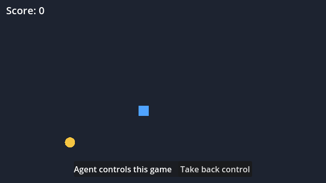

# genaicode in the Godot editor

A Godot 4.5 project where a coding agent CLI (Claude Code, Codex...) works in the editor and
also plays the game. It is a small example of [`genaicode acp`](../../embedding.md#any-language-the-agent-client-protocol)
in a host that is not written in JavaScript.

- `addons/genaicode/plugin.gd` adds an **Agent** dock: a chat with the agent about this
  project, with pickers for the agent, its effort and approvals, and Allow / Reject when the
  agent asks for permission. It starts `npx -y genaicode acp` and speaks the Agent Client
  Protocol over its stdin and stdout (`acp_client.gd`, about 120 lines of GDScript).
- `addons/genaicode/game_mcp.gd` is an autoload: while the game runs (debug builds only) it
  serves MCP tools on `http://127.0.0.1:7777/mcp`. The dock hands that server to the agent, so
  the agent can `game_observe` (state and a screenshot), `game_take_control`, `game_act` (hold
  keys for some frames) and `game_release_control`. The game shows **Agent controls this game**
  with a **Take back control** button and stays paused between the agent's moves.
- `main.gd` is the game: steer the square onto the star. It describes itself to the agent
  with `agent_state()`.

<p align="center">
  
</p>

What the dock showed in a test run with Claude Code (abridged):

```text
You: The game is running. Play it with the game tools: take control, collect 2 stars, then release control.
• mcp__game__game_observe
• mcp__game__game_take_control
• mcp__game__game_act
Great! Collected the first star. Score is now 1. The second star appeared at [358, 109].
• mcp__game__game_act
Perfect! I've collected both stars. The score is now 2. Releasing control back to the player.
• mcp__game__game_release_control
```

## Run it

You need Node.js 20+ and an agent CLI you are logged in to (`npx genaicode agents` lists them).

1. Open this folder in Godot 4.5. The plugin is already enabled; the Agent dock is next to the
   Inspector.
2. Ask the agent about the project, e.g. "make the star move slowly".
3. Press F5 to run the game, then ask: "Play the game: take control and collect 3 stars."

Set `GENAICODE_ACP_COMMAND` before starting Godot to run another command, e.g.
`npx -y genaicode acp -a codex` or a local checkout's `node /path/to/genaicode/dist/cli.js acp`.

## In your own project

Copy `addons/genaicode` into it and enable the plugin (Project Settings → Plugins). For the
game tools, add `game_mcp.gd` as an autoload, put the node that runs the game in the
`agent_game` group, and give it an `agent_state()` that returns what a player would need to
know as a Dictionary. The keys the agent may press are in `KEYS` at the top of `game_mcp.gd`.

The game tools listen on 127.0.0.1 only and refuse browser requests (any `Origin`) and other
`Host` names. They exist for development: release builds do not start them.
